# Aether

Aether is a game menu for the Satiator on the Sega Saturn. It shows your games with cover art, keeps saves per game, and launches games from any region.

Aether Card Manager is its PC app (Windows, macOS, Linux). It sets up the SD card and manages covers, names and backups.


## Features

- Cover art in the game list and on the loading screen
- Launch Options for each game: loader, saves, save slot, cheats, In Game Reset
- CWX and JHL loaders, with Auto picking one per game
- Saves kept per game on the SD card, plus a save manager for the console, cartridge and card
- Cheats, with an editor for adding your own
- In Game Reset: A+B+C+Start in a game goes back to Aether
- Disc swapping with the console lid
- Plays games from any region
- Themes
- Card Manager: game library, covers, database edits, PC backups, self-update, and feedback

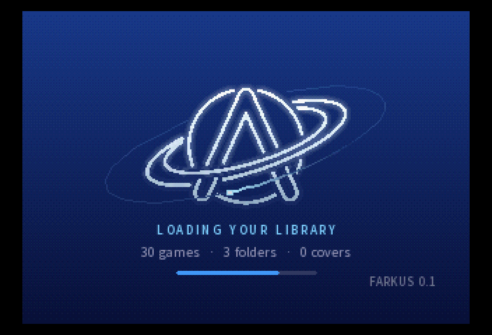 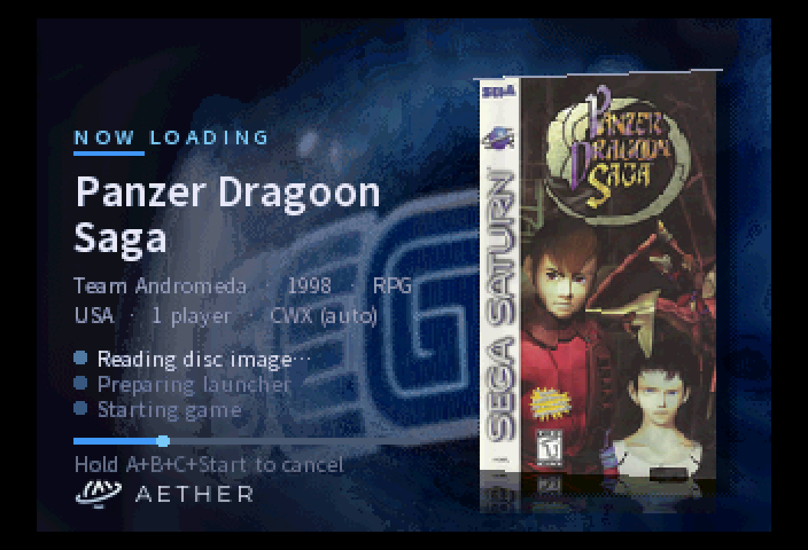

## Getting started

1. Download Aether Card Manager for your PC from the [Releases page](https://github.com/likeagfeld/Aether/releases).
2. Format the SD card as FAT32 or exFAT, and copy your games onto it (see [Putting games on the card](#putting-games-on-the-card)).
3. Open the Card Manager, pick the SD card and click **Prepare SD Card for Aether**.
4. Put the card in the Satiator and power on.

### Putting games on the card

Give each game its own folder, with all its tracks inside. You can put those folders straight on the card or group them into folders of your own, up to 8 levels deep:

```
SD card
├── Panzer Dragoon Saga (USA)/          one disc: one folder
│   ├── Panzer Dragoon Saga (USA) (Disc 1).cue
│   ├── Panzer Dragoon Saga (USA) (Disc 1) (Track 1).bin
│   └── ...
├── Shooters/                           your own folder, shown as a folder in Aether
│   ├── Radiant Silvergun (Japan)/
│   │   ├── Radiant Silvergun (Japan).cue
│   │   └── Radiant Silvergun (Japan) (Track 1).bin
│   └── Batsugun (Japan)/
│       └── Batsugun (Japan).iso
├── Enemy Zero (USA)/                   several discs: all of them in one folder
│   ├── Enemy Zero (USA) (Disc 1).cue
│   ├── Enemy Zero (USA) (Disc 1) (Track 1).bin
│   ├── Enemy Zero (USA) (Disc 2).cue
│   └── ...
└── aether/                             made by the Card Manager: Aether itself, saves, covers (leave it alone)
```

- A folder with exactly one `.cue` or `.iso` in it, and no folders inside, shows as one game, named after the folder.
- Any other folder shows as a folder you can open. Its games are listed by file name.
- A game can also sit loose in a folder, next to other games. It is then listed by its file name.
- Keep a multi-disc game's discs together and leave "Disc 1", "Disc 2" and so on in their names. **Save changes** in the Card Manager then links them, so the console lid swaps discs.
- Aether skips `/aether`, the root `/SAVES` folder (Satiator Menu Kai's saves), hidden files and the Satiator's own files (`menu.bin`, `autoboot.iso`, Rings' folders).
- After you add, remove or move games, open the card in the Card Manager. The main button reads **Update card to 0.1**; click it to bring Aether's list up to date, with covers for the new games and multi-disc sets linked. Hover over the button to see how many games are new or gone.
- A big collection reads faster when it is split into folders. Keep any one folder, especially the root, to a few hundred items.

### Supported disc images

- **Works:** `.cue` with `.bin` or `.wav` tracks (MODE1/2048, MODE1/2352, MODE2/2352 and AUDIO; several tracks or files are fine), and plain `.iso` with 2048-byte sectors.
- **Not supported:** `.cdi`, `.chd`, `.mds`/`.mdf`, `.ccd`/`.img`/`.sub`, and zipped or 7z images. Convert them to CUE/BIN first (for CHD, use `chdman extractcd`).

## Controls

| Button | In the game list |
|---|---|
| A | Open a folder, or open Launch Options for a game (A on Launch starts it) |
| B | Back |
| X | Add to or remove from Favorites |
| Y | Sort (A-Z, genre, region, year) |
| Z | Filter |
| L / R | Page up / down |
| Start | Settings |
| L+R+Start | Diagnostics |
| A+B+C+Start (in a game) | In Game Reset: back to Aether |

You can remap the buttons in Settings > Controls.

## FAQ

### Getting started

**1. What do I need?**

A Satiator with firmware 161 or newer, an SD card formatted FAT32 or exFAT, and a Windows, macOS or Linux PC. Windows can't format a card over 32 GB as FAT32, so use exFAT for big cards.

**2. How do I set up a new SD card?**

Copy your games onto the card, open it in the Card Manager and click **Prepare SD Card for Aether**.
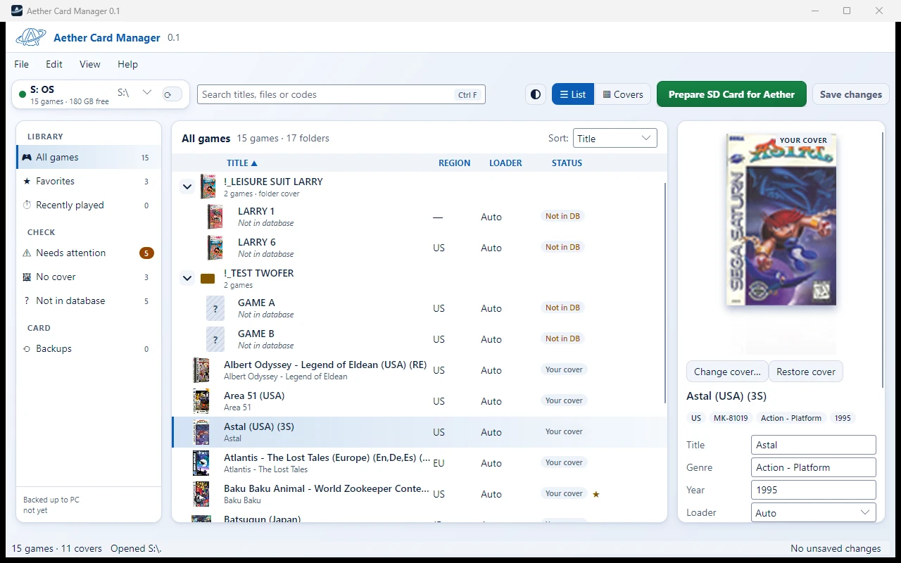

**3. Does it replace the Satiator menu?**

No. `/menu.bin` is never touched. Any existing `/autoboot.iso` is kept as `autoboot.iso.bak-<date>`.

**4. Windows or macOS won't open the Card Manager.**

The app isn't signed by a registered developer, so your system warns about it the first time. On Windows, click **More info > Run anyway**. On macOS, the app isn't notarized by Apple, so macOS says it can't verify it is free of malware. Click **Done** (not Move to Trash), open **System Settings > Privacy & Security**, click **Open Anyway** next to AetherCardManager and confirm. After that it opens normally.

If macOS says the app is damaged, run `xattr -cr /Applications/AetherCardManager.app` in Terminal, then open it again.

**5. I'm coming from Rings, the Satiator Menu or Satiator Menu Kai. What happens to my saves and settings?**

On the console, **Settings > Manage / Import Saves > Import from Rings / Kai** copies your Rings and Satiator Menu Kai saves into Aether. Settings don't carry over, so set them again in Aether.

### Card Manager

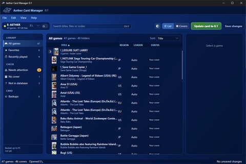

**6. How do I add games?**

Copy each game's folder onto the card, laid out as in [Putting games on the card](#putting-games-on-the-card). Then open the card in the Card Manager and click **Update card to 0.1**. It adds the new games to Aether's list with their covers.
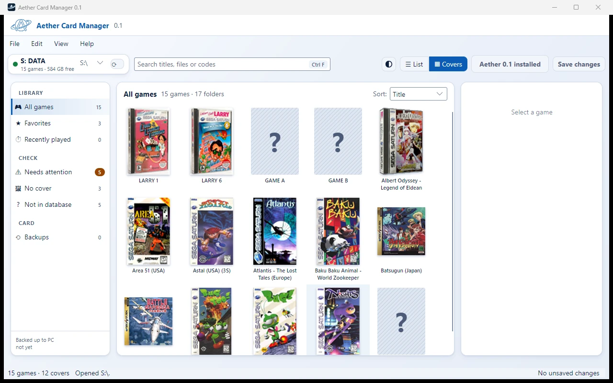

**7. A game says "Not in database". How do I fix its name?**

Select it and click **Add to database...**, or right-click it and choose **Match to game...**. Then click **Save changes**.
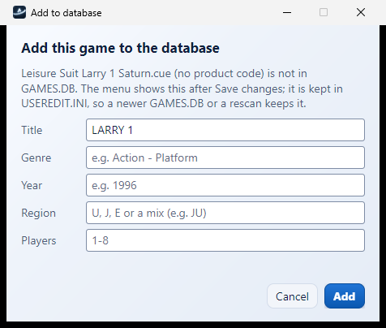

**8. How do I name homebrew or a translation and give it a cover?**

Use **Add to database...** for the name. For the cover, use **Change cover... > From file...**.

**9. How do I change or add a cover?**

Select the game, click **Change cover...**, pick one, then **Save changes**.
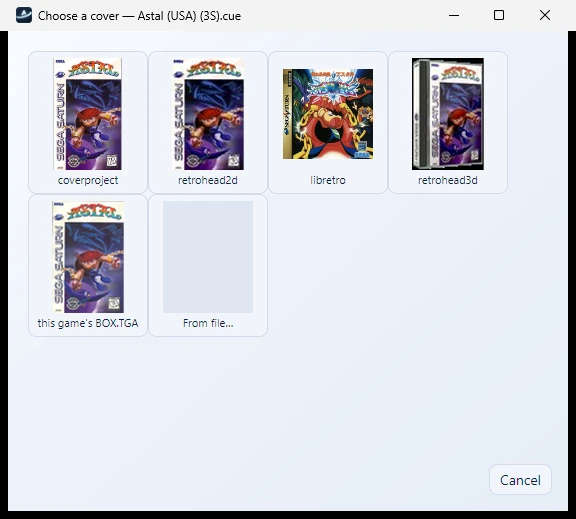

**10. How do I make a multi-disc game swap discs?**

Keep all its discs on the card, then click **Save changes**. In the game, open and close the lid when it asks for the next disc.

**11. How do I update the card or the Card Manager?**

**Help > Check for updates...** updates the Card Manager (on macOS it opens the Releases page to download the new version). When a card needs the new Aether, the main button reads **Update card**. It backs up your files to the PC first.

**12. How do backups and restore work?**

Each time you open a card, the Card Manager backs up your saves, edits and covers to the PC. To get them back, use **File > Restore from backup...**. **File > Open backups folder** shows where they are.

**13. Can I use light or dark mode?**

Yes: **View > Theme**, or the round button in the toolbar.

**14. How do I report a problem or suggest something?**

Use **Help > Send feedback...**. It fills in a GitHub issue for you, and nothing is sent until you submit it there.
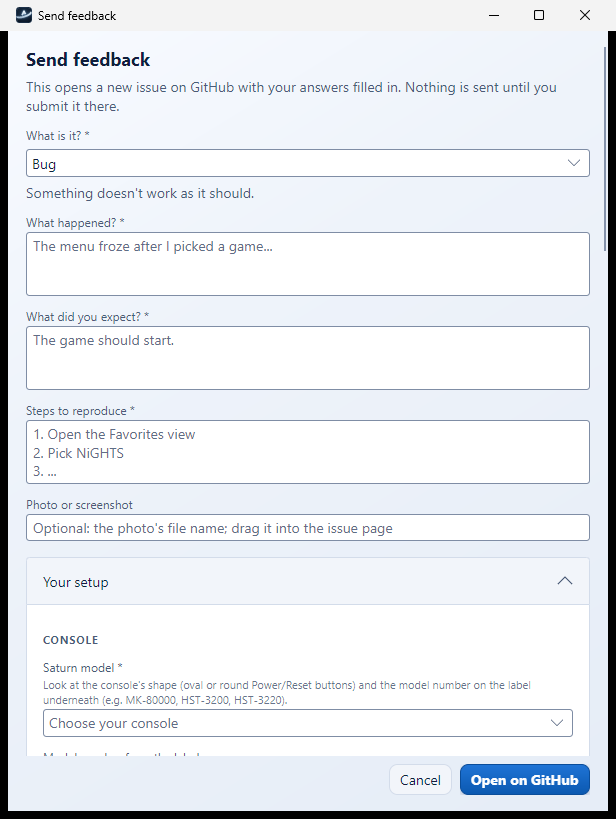

### On the console

**15. How do I launch a game, and what are Launch Options?**

Press A on a game to open Launch Options, then A on **Launch** to start it. The other rows set the loader, saves, slot, cheats and In Game Reset for that game. B closes and saves.
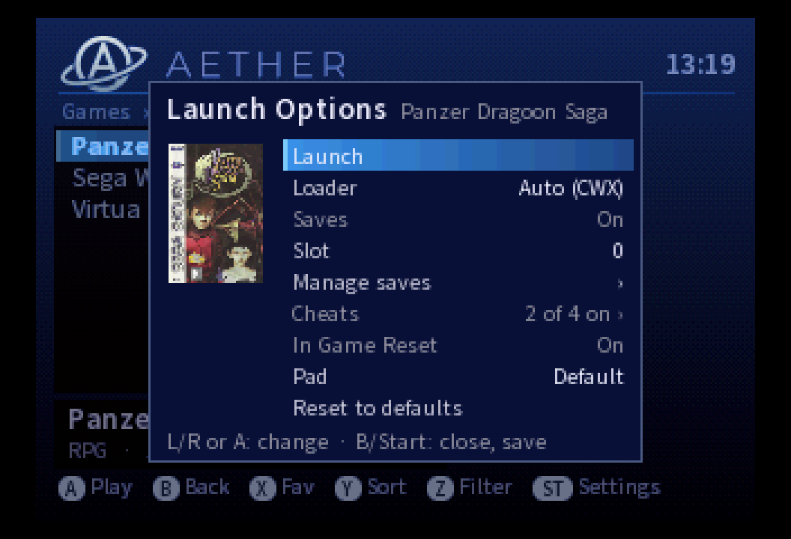

**16. Auto, CWX or JHL?**

Leave it on Auto, which picks the right loader for each game. If a game won't boot, try the other one. Cheats need CWX.

Multi-disc games use JHL so disc swapping works.

**17. How do I get back to Aether from a game?**

Press A+B+C+Start (In Game Reset).

**18. Why is there a short pause before a game starts?**

Aether is swapping that game's saves into the console's memory. Keep the power on.

**19. How do cheats work, and can I add my own?**

In Launch Options, open **Cheats**. A turns a cheat on or off, and X adds your own. Cheats only work with the CWX loader.

Cheats need CWX, so they aren't available on multi-disc games for now (they use JHL for disc swapping); you can force CWX per game in Launch Options, but then opening the lid to change discs won't work.
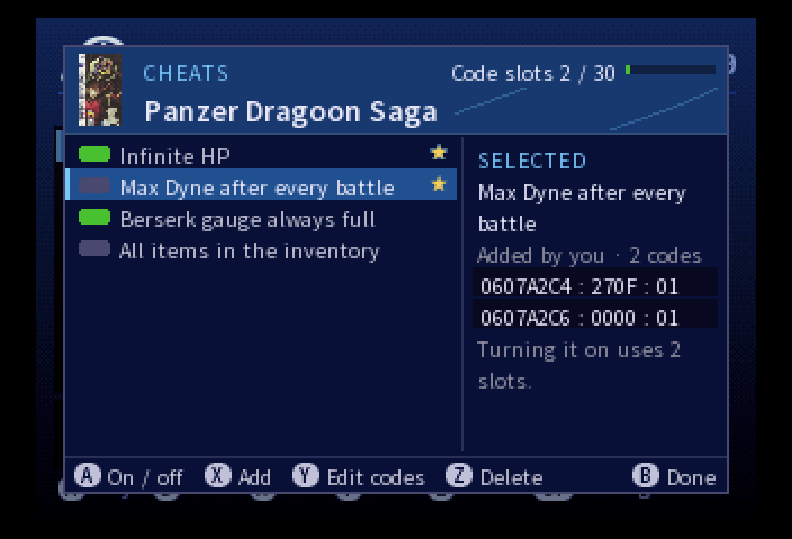

**20. How do I manage saves?**

Open **Manage saves** in Launch Options for one game, or **Manage / Import Saves** in Settings for every game. You can copy saves between the console, the cartridge and the card, back them up, or delete them.
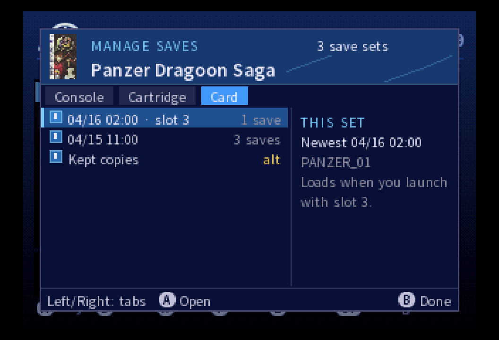

**21. How do I swap discs?**

Open the lid when the game asks for the next disc, then close it: the console boots the next disc. For games that exit when the lid opens (like Enemy Zero), the console's CD player appears: close the lid, then choose **Start Application** to boot the next disc. After that, A+B+C+Start no longer returns to Aether for the rest of that game: switch the console off and on to get back. Opening the lid at any other time exits the game.

**22. What is the "Pad" note?**

Some games need a particular controller, and the Pad note says which. If a 3D Control Pad in analog mode won't work with a game, Aether warns you before it launches.

**23. Can I play games from other regions?**

Yes.

**24. Can I change the music, sounds or screensaver?**

Yes. Settings has **Music**, **Sounds** and **Screensaver**.
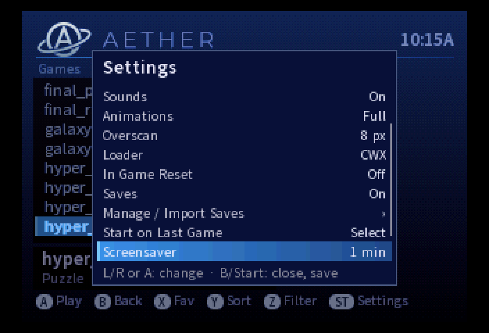

**25. What is the diagnostics screen?**

Hold L+R and press Start in the game list. It shows your firmware, BIOS, region and controller details, which are useful when you report a problem.
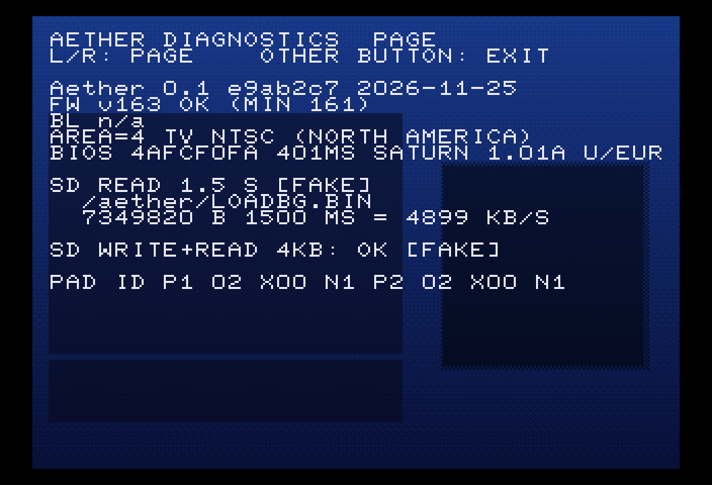

**26. Can I use a 1MB/4MB RAM cart or an Action Replay?**

Yes. Aether detects the cartridge. A cartridge with save memory appears in Manage saves.

**27. Do NetLink games work?**

They launch like any other game. Per-game NetLink settings aren't in this version.

**28. Why does the console ask me to set the clock?**

The console's internal battery is flat. Replace it (a CR2032 coin cell) and the clock will stay set.

### Troubleshooting

**29. A game won't boot.**

In Launch Options, set Loader to JHL or CWX. If it still won't boot, turn In Game Reset off for that game. If that doesn't help either, report it with **Help > Send feedback...**.

**30. Are there known issues?**

In Game Reset can't return from a few games, such as Astal or the Grandia translation. With In Game Reset off, CWX games reset instead of opening the CD player. See [Known issues](#known-issues).

## Known issues

- In Game Reset can't return to Aether from a few games, such as Astal and the Grandia English translation; they reset the console instead.
- A few JHL-only games with a large disc header can't use In Game Reset, for example Daytona USA when it is forced to JHL. In those games, A+B+C+Start goes to the CD player. Use Auto or CWX where the game supports it.
- With In Game Reset off, CWX games reset the console instead of opening the CD player.

## Credits and licenses

See [CREDITS.md](CREDITS.md). License texts are in `LICENSES/`.

| Path | License |
|---|---|
| `menu/` | BSD-3-Clause (some files MPL-2.0; `menu/launcher/kai` GPL-2.0; `menu/lib/satiator` public domain) |
| `manager/` | GPL-3.0-or-later |
| `tools/`, `contract/` | MIT |
